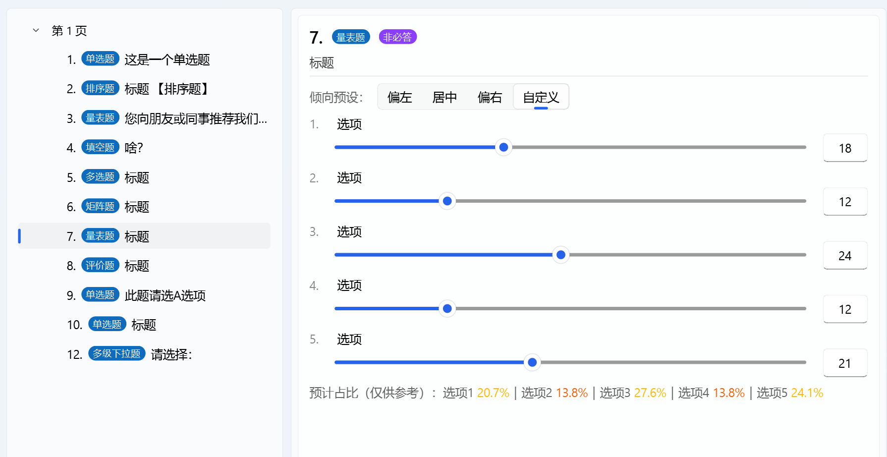

<div align="center">
  
  <h1>SurveyController</h1>
  
  [](https://github.com/SurveyController/SurveyController/stargazers)
  [](https://github.com/SurveyController/SurveyController/releases/latest)
  
  [](https://github.com/SurveyController/SurveyController/issues)
  [](https://www.python.org/)
  [](./LICENSE)

  <p>开源的问卷自动化处理程序，适用于问卷星、腾讯问卷、Credamo见数平台</p>
  

</div>

> [!WARNING]
> **该项目仅供 HTTP 接口自动化学习与测试使用。** 请确保拥有目标测试问卷的授权再使用，**严禁污染他人问卷数据！**

---

## 功能特性

| 平台 | 问卷星 | 腾讯问卷 | Credamo（见数） |
| --- | --- | --- | --- |
| 问卷二维码解析 | ✅ | ✅ | ✅ |
| Excel 反填 | ✅ | ❌ | ❌ |
| 自定义答案比例 | ✅ | ✅ | ✅ |
| 随机/指定ip地区 | ✅ | ✅ | ✅ |
| 模拟作答设备 | ✅ | ✅ | ✅ |
| 指定作答时长 | ✅ | ✅ | ✅ |
| 指定作答日期 | ❌ | ❌ | ✅ |
| AI 主观题作答 | ✅ | ✅ | ✅ |

> 用于二次开发或调试的用户，可以参考 [surveycore-py](https://github.com/SurveyController/surveycore-py) 核心库的实现和示例
>
> 🤗欢迎向 [surveycore-py](https://github.com/SurveyController/surveycore-py) 提交新的题型或平台适配 PR！

## 开始使用

### 使用要求

- Windows 10/11 x64
- 具备基础的文字理解能力
- 拥有足够的耐心
- 具备勇于尝试与探索的精神
- 掌握截图等用于提问的基本操作技能

> [!NOTE]
>  - MacOS 用户请前往 [SurveyController-Mac](https://github.com/SurveyController/SurveyController-Mac) 仓库
>  - Android 用户请前往 [SurveyController-Android](https://github.com/SurveyController/SurveyController-Android) 仓库
>
> ⚠️请注意，它们由社区维护，可能存在功能更新不及时或不可用的情况。非刚需用户**请尽量使用本仓库的 Windows 版本**

### 下载安装

- 前往 [Release](https://github.com/SurveyController/SurveyController/releases/latest) 下载最新版本 .exe 安装包，安装后直接运行即可

- **你也可以通过 [](https://dl.hungrym0.com/SurveyController_latest_setup.exe) 分发源获得更快的下载速度**

### 从源码运行

[](https://docs.astral.sh/uv/)

```bash
git clone https://github.com/SurveyController/SurveyController.git
cd SurveyController
uv sync
uv run python SurveyController.py
```

如果还没装 uv，请先执行：
```powershell
powershell -ExecutionPolicy ByPass -c "irm https://astral.sh/uv/install.ps1 | iex"
```

## 使用方法

会认字即可。详细使用说明见[教程文档](https://surveydoc.hungrym0.com/)

## 交流群

如有疑问或需要技术支持，可加入QQ群：
346131215


## 贡献者

感谢以下贡献者对本项目的支持：

<div style="display: flex; gap: 10px;">
  <a href="https://github.com/shiaho777">
    
  </a>
  <a href="https://github.com/BingBuLiang">
    
  </a>
  <a href="https://github.com/dAwn-Rebirth">
    
  </a>
  <a href="https://github.com/zioug">
    
  </a>
  <a href="https://github.com/qintaiyang">
    
  </a>
  <a href="https://github.com/LING71671">
    
  </a>
  <a href="https://github.com/Quchaosheng">
    
  </a>
</div>

## Star History

[](https://www.star-history.com/#SurveyController/SurveyController&type=date&legend=top-left)
